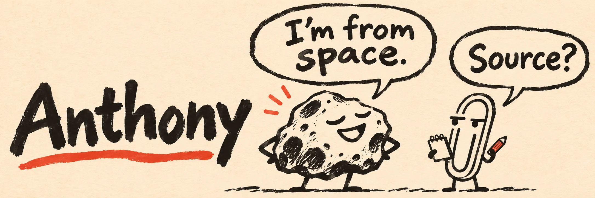

# 

<strong>Hangyuan Zhang</strong> · Data science undergraduate Southern University of Science and Technology (SUSTech) · Expected June 2027

<a href="https://lanthonyj.github.io/Hangyuan-Zhang-CV.pdf">One-page CV (PDF)</a> · <a href="https://lanthonyj.github.io/">Portfolio</a> · <a href="mailto:zhanghangyuan19@163.com">Email me</a>

## 🔬 Research interests

How can we tell whether an AI-generated answer holds up? Sometimes I can run the SQL it wrote. When the answer is a scientific claim, I want to read the passage it came from.

In my undergraduate research on **cancer metabolism**, I built a search tool that keeps conflicting findings about the same reaction side by side. It combines keyword and semantic search, links each finding to its source, and checks generated citations against the original excerpts. [Read the research overview](https://lanthonyj.github.io/#research)

## 🛠️ Selected projects

| Project | My contribution | Explore |
| :--- | :--- | :--- |
| **[DataLens Lab](https://github.com/LAnthonyJ/datalens-lab)** | I fine-tuned Qwen3.5-0.8B, then tested its SQL and its ability to ask for missing data on 24 held-out prompts. | [Results](https://github.com/LAnthonyJ/datalens-lab#what-the-experiments-found) · [Video](https://github.com/LAnthonyJ/datalens-lab/blob/main/12311701_%E5%BC%A0%E8%88%AA%E6%BA%90.mp4) |
| **[Intelligent Scissors](https://github.com/LAnthonyJ/intelligent-scissors-java)** | I used Sobel edges and Dijkstra’s algorithm to trace an object between clicks in a Java Swing editor. Close the outline to save a transparent PNG. | [Leaf sample](https://github.com/LAnthonyJ/intelligent-scissors-java#try-the-leaf-sample) |
| **[NLP in PyTorch](https://github.com/LAnthonyJ/-nlp-)** | I compared two methods on 768 held-out prompts. Across four tasks, training on correct answers averaged 52.73% accuracy and direct preference optimization averaged 45.57%. | [Report](https://github.com/LAnthonyJ/-nlp-/blob/main/docs/hard-pairs-v3-results/README.md) |
| **[LithoLens](https://github.com/LAnthonyJ/LithoLens)** | I worked on modeling and evaluation in a five-person team. Our meteorite classifier reached 0.86046 F1 on the competition’s second-stage private test set. | [Results](https://github.com/LAnthonyJ/LithoLens#competition-results) |

## 🌱 Open source

**Prompt Optimizer** · I fixed a case where non-streaming OpenAI, MiniMax, and DeepSeek responses reported token counts that never reached the caller, and added regression tests for all three providers. [Merged PR #379](https://github.com/linshenkx/prompt-optimizer/pull/379)

**More projects** · [A 70-match backtest of World Cup forecasts](https://github.com/LAnthonyJ/worldcup_prediction/blob/master/PROJECT_PROGRESS.md)
